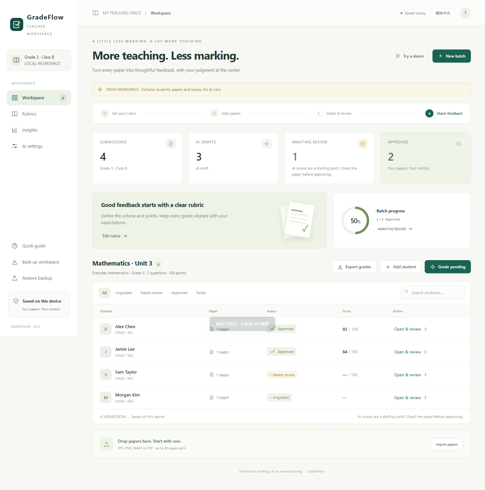
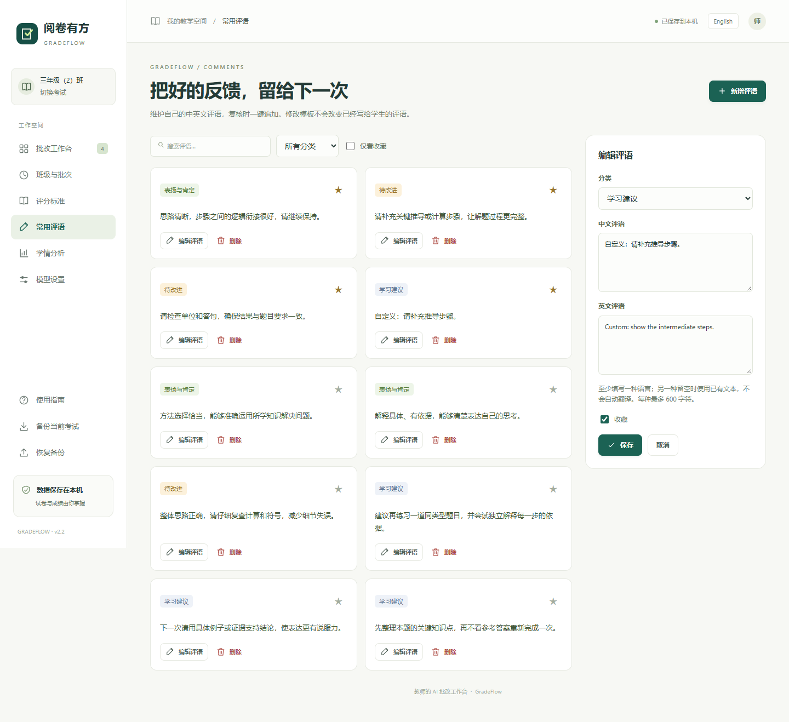
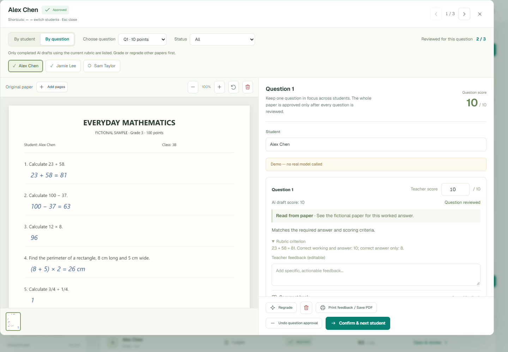
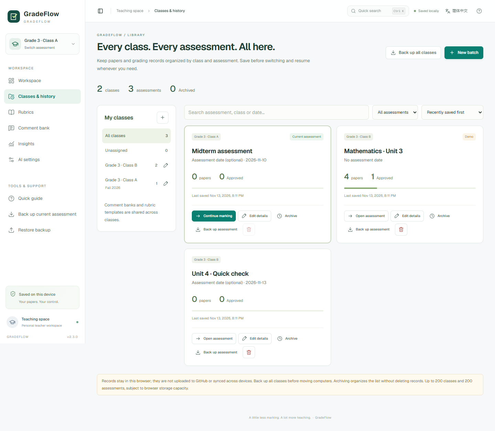

# GradeFlow · 阅卷有方

**Less marking. More teaching. A bilingual paper-grading workspace that keeps teachers in control.**

[English](README.md) · [简体中文](README.zh-CN.md) · [Research & roadmap](docs/research.md)

**[Open in English](https://jianshengchuanchaun.github.io/paper-grading-assistant/en/)** · **[打开中文版](https://jianshengchuanchaun.github.io/paper-grading-assistant/zh/)** · [Downloads](https://github.com/jianshengchuanchaun/paper-grading-assistant/releases)



Upload a student's paper, apply your own rubric, review the suggested marks alongside the original, and export the grades you have approved. GradeFlow is a browser-based assistant for teachers, with Chinese and English interfaces from one shared codebase.

## What works today

- **Classes and assessment history:** keep separate papers, rubrics, grades and review progress for each assessment. Create/rename classes, move assessments, search, archive/unarchive and resume work without replacing previous records.
- **Teacher-controlled rubrics:** explicit question IDs, maximum points, scoring criteria, reusable templates, and additional instructions.
- **Images and PDFs:** JPG, PNG, WebP, multi-page PDF, drag and drop, and image paste inside a student's review. PDF pages render locally using bundled PDF.js.
- **A focused review workspace:** original paper and marks side by side, zoom, page rotation, editable scores and comments, original AI scores, and an edit history.
- **Review by question:** keep one question in focus while switching students, filter pending or flagged answers, and confirm a question before moving to the next unreviewed student. A paper becomes approved when every question is reviewed.
- **Bilingual comment bank:** nine editable starter comments, your own Chinese/English feedback, three categories, search and favorites. Append feedback to a question without replacing existing notes or changing scores.
- **Review before reporting:** incomplete answers stay unscored; official exports and class statistics only use complete, current, teacher-approved results.
- **Resumable local work:** each assessment persists separately in IndexedDB; templates and comments are shared. Export one assessment or the entire class library. v2.0/v2.1 workspaces migrate automatically. Conflicting writes from another tab are blocked.
- **Class insights:** score distribution, pass rate, per-question performance, and lower-scoring questions to discuss in class.
- **Useful outputs:** Excel-compatible CSV with formula-injection protection; individual printable feedback that can be saved as PDF through the browser's print dialog.
- **Your choice of model:** vision-capable OpenAI-compatible Chat Completions APIs, editable URL and model ID, plus an optional local relay for providers that do not allow browser calls.
- **Chinese and English:** `/zh/` and `/en/` entry points, language switch, localized controls and AI feedback prompts.
- **An offline demo:** synthetic papers and fictional scores, clearly labeled in the interface and exports. No account or AI API is needed to try it.

## Quick start

Requires **Node.js 22.13+** (Node.js 24 recommended).

```sh
npm ci
npm run build
npm start
```

Open [the local workspace](http://localhost:4173/), [the English version](http://localhost:4173/en/), or [the Chinese version](http://localhost:4173/zh/). Select **Try a demo** to explore the full workflow without sending anything to an AI service.

For a real class:

1. Open **Classes & history**, create a class, then create an assessment with **New batch**. Existing records remain in history. Enter a rubric, reuse the current one, or use a saved template. Text imports add supplemental instructions; they do not extract a question list automatically.
2. Import papers. **Each file creates one student; each PDF must contain one student's work.** Open a student to add more pages to the same paper.
3. Configure a vision model in **AI settings**. A successful connection test checks text connectivity; use a sample paper to verify vision capability.
4. Select **Grade pending**. The queue runs sequentially, supports stopping, and keeps completed results. Existing successful results are skipped. Individual regrading requires an explicit replacement confirmation.
5. Review the original and suggested marks. Use **By student** to approve a whole paper, or **By question** to confirm individual questions across students. Add feedback from your **Comment bank** as needed.
6. Export official grades, print individual feedback, or back up the workspace.

You can open `index.html` directly for the demo and basic image workflow. PDF module loading and the local relay require HTTP/HTTPS. Browser storage and direct API calls may also be restricted for `file://` pages; the local server or a static HTTPS host is recommended.

## Two ways to make review easier

In **Comment bank**, add or edit feedback under **Strengths**, **Improvements** or **Next steps**. Each entry can contain Chinese and English wording. The current interface language chooses which text is appended; if it is missing, the other language is used and labeled. These are editable templates, not automatic translations. Favorite frequently used comments and search either language. Inside a question, expand **Comment bank** and click a comment to append it. Existing feedback stays intact, and the same whole comment is not added twice. Editing or deleting a template leaves previously given feedback unchanged.



After generating AI drafts, choose **By question**, select a question ID, and use the student strip or arrow keys to compare that question across the class. **Confirm & next student** saves the current question's review and moves to the next unreviewed student in the current filter. The progress count shows how many eligible papers have that question reviewed. Unscored answers require a score before confirmation; unfinished or outdated drafts must be graded first. You can switch back to **By student** at any time.



Confirming one question does not approve the entire paper. Every question must be reviewed and scored under the current rubric. Changing a score or feedback clears that question's confirmation and the paper's approval, keeping other question confirmations. Both new features work locally and make no extra AI calls. JSON backups include the bank and review progress; restoring an older backup without a bank keeps your current comments.

## Classes, history and backups



Use **Classes & history** to organize classes and assessments. A new assessment can reuse the current rubric, but starts without students or grades. Existing assessments stay intact. Switch using the workspace selector or **Open assessment** on a history card. You can rename classes, edit an assessment's name/date/class, search by name or date, sort by save time or assessment date, and archive completed work. Archiving is a list filter, not deletion or a read-only lock; open archived work from the Archived list to continue editing.

| Action | What it does |
| --- | --- |
| Back up current assessment / Back up assessment | Downloads one assessment, pages, review history, templates and comment bank as a version-2 JSON backup. |
| Back up all classes | Downloads every class and assessment, including archived work, shared templates and comments, as a version-3 JSON backup. It does not require an extra write, so it remains usable after a storage-quota failure. |
| Restore a single-assessment backup | Adds a new assessment without removing existing ones; restores the included shared templates/comments. A missing comment bank leaves the current bank intact. |
| Restore an all-classes backup | Replaces the complete local library after confirmation. The archive is validated before one atomic write. Back up records you want to keep first. |
| Delete assessment | Permanently removes that assessment after confirmation. Switch away from the current assessment before deleting it. |
| Delete empty class | Allowed only when the class contains no assessments, including archived ones. |

Data remains in this browser and origin. Publishing the app to GitHub does **not** upload teacher records or sync devices. The online Chinese/English entries share storage in the same browser; local hosting, another browser/profile, or another computer has separate storage. Use all-class backup/restore to move work. Clearing site data or using a temporary browser profile can remove records. A second tab that has stale data must reload before it can save, preventing silent overwrites.

The catalog supports up to 200 classes and 200 assessments; each assessment retains the existing 500-student and 20-page-per-student limits. Browser storage capacity is the practical limit. Backup import is capped at 180 MB. No large-class stress test or cloud synchronization is claimed.

For a recording walkthrough, see the [English demo guide](docs/DEMO_GUIDE.en.md), [Chinese Bilibili recording script](docs/BILIBILI_SCRIPT.zh-CN.md), and [fictional sample papers](docs/demo-materials/README.md).

## Connecting an AI service

### Browser connection

Choose a preset or enter an OpenAI-compatible base URL and a vision model ID. Enter your API key. The key is held **only in page memory** and disappears on reload. It is not stored in IndexedDB or workspace exports.

**DeepSeek**: select **AI settings → Browser connection → DeepSeek** to prefill `https://api.deepseek.com` and `deepseek-flash`. Enter your own DeepSeek API key, save, then test the connection. The connection test sends text only; try one paper next to check image reading and grading. The [official DeepSeek vision guide](https://api-docs.deepseek.com/guides/vision/) documents image support for `deepseek-flash`; verify vision support before changing models. Direct requests using this preset disable thinking so the output budget is available for the connection reply and grading JSON. Provider usage charges apply.

The provider must allow cross-origin browser requests. If it does not, use the local relay. Provider availability, model IDs, image support, pricing and account limits can change; no model is represented as permanently free or universally compatible.

### Optional local relay

Copy `.env.example` to `.env` and configure:

```dotenv
OPENAI_BASE_URL=https://your-provider.example/v1
OPENAI_MODEL=your-vision-model-id
OPENAI_API_KEY=your-private-key
PORT=4173
```

Restart `npm start`, then select **Local relay (.env)** in settings. The relay listens on `127.0.0.1` only, requires same-origin requests, and uses the server-configured model and destination. It never accepts a destination URL from a browser request. **This local relay is not a multi-user production backend.** GitHub Pages serves static files and cannot run it.

## Data and grading boundaries

- Uploaded pages, rubrics and grades are stored in the current browser profile. Clearing browser data removes them. Export backups before changing devices or clearing data. Backups are plaintext and contain student work.
- Real grading sends the rubric and images to the configured provider. Names entered in the roster are not added to the prompt, but names visible **on the page itself** remain visible to the provider. Images are not automatically anonymized.
- Model outputs are validated against the teacher's question IDs and maximum points. Missing/unreadable answers remain `null`, duplicate/unknown IDs and out-of-range scores are rejected, and mismatched maxima are flagged.
- A rubric or strictness change invalidates old approvals. Editing a score or teacher comment also requires renewed approval. Changing pages clears the affected student's result.
- AI review flags are suggestions, not calibrated probabilities. Teachers should verify all results. No grading-accuracy claims have been established for this project.
- There is no analytics, advertising, remote font, automatic cloud synchronization, or production AI key bundled with the app.

## Current limits

Multiple saved assessments per browser origin, with one selected at a time. Per-assessment limits are **500 students**, **100 questions**, and **20 pages per student**; input files are limited to **25 MB**, and imported backups to **180 MB**. Actual capacity depends on browser storage and device memory. The local relay accepts up to 30 MB per request; API providers may impose lower limits. Images are reduced to a maximum edge of 1900 pixels.

Not implemented: automatic separation of mixed-student scan bundles, OCR editing before scoring, on-paper annotation, LMS synchronization, live collaboration, automatic rubric extraction, server-side accounts, or a validated grading benchmark. Password-protected PDFs need to be unlocked before import. HEIC requires conversion to JPG/PNG.

## Development and checks

Plain HTML, CSS and JavaScript keep the application inspectable. PDF.js is the only runtime package; it is copied into the static build so PDFs do not require a CDN.

```sh
npm run check     # JavaScript syntax + scoring, backup and relay tests
npm run build     # dist/, language entry points, local PDF assets
npm run test:ui   # Browser workflows (Edge on Windows, Chromium elsewhere)
```

For Linux/macOS UI tests, install the Playwright browser once with `npx playwright install chromium`. Windows tests use installed Microsoft Edge. The optional CI template installs Chromium automatically.

```text
assets/app.js       UI, local persistence, import, grading queue and reports
assets/core.js      Scoring validation, prompt construction, backup and CSV rules
assets/library.js   Class catalog, archive validation and atomic IndexedDB operations
assets/i18n.js      Chinese and English UI strings
assets/comments.js  Editable bilingual starter feedback
assets/styles.css  Responsive workspace and review interface
scripts/server.mjs Local static server and optional fixed-destination relay
scripts/build.mjs  Portable static build, including PDF.js
tests/             Unit, relay and browser workflow checks
docs/              Screenshots, research, roadmap and release notes
```

## Publish to GitHub Pages

The published site serves the built `dist/` output from the `gh-pages` branch, including `/zh/` and `/en/`. To deploy a fork, build the app, put the contents of `dist/` at the root of a `gh-pages` branch, then select **Settings → Pages → Deploy from a branch → gh-pages / (root)**.

Optional GitHub Actions templates are provided in [`docs/workflows/`](docs/workflows/). To enable automated checks and manually dispatched deployment, copy them into `.github/workflows/` and select **GitHub Actions** in Pages settings. Uploading executable workflow files through GitHub CLI requires the additional `workflow` authorization scope. The templates are not active workflows in this release.

Use browser connection mode with a CORS-enabled provider on a static deployment. For local relay mode, run the app on your own computer.

## Inspiration and attribution

The product research considered [ExamGrader](https://github.com/CCU-Bioinformatics-Lab/ExamGrader), [ZhuPi](https://github.com/Qnh233/zhupiAI), [CorrectExam](https://github.com/correctexam/corrigeExamFront), [OpenGrader](https://github.com/ISC-HEI/opengrader), and [Gradescope's review workflow](https://guides.gradescope.com/hc/en-us/articles/37290703633677-Submission-navigation-and-keyboard-shortcuts). Their source code, assets and proprietary designs were not copied. See [research notes](docs/research.md) for the feature decisions and remaining questions.

Built from the project owner's initial paper-grading prototype. New application code is released under the [MIT License](LICENSE). Bundled PDF.js is Apache-2.0; its license accompanies the build. Screenshots contain generated, fictional examples.
