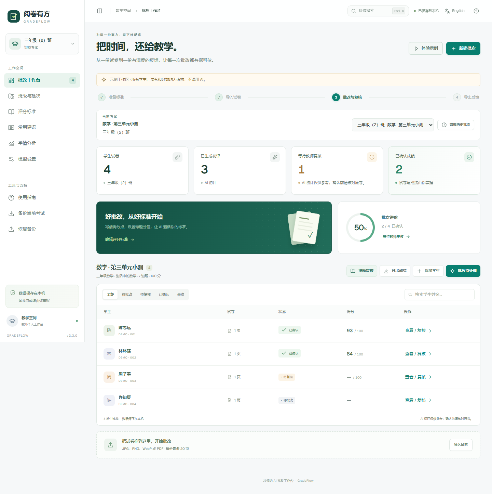
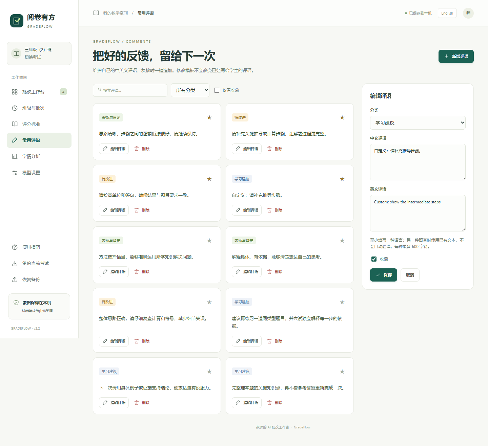
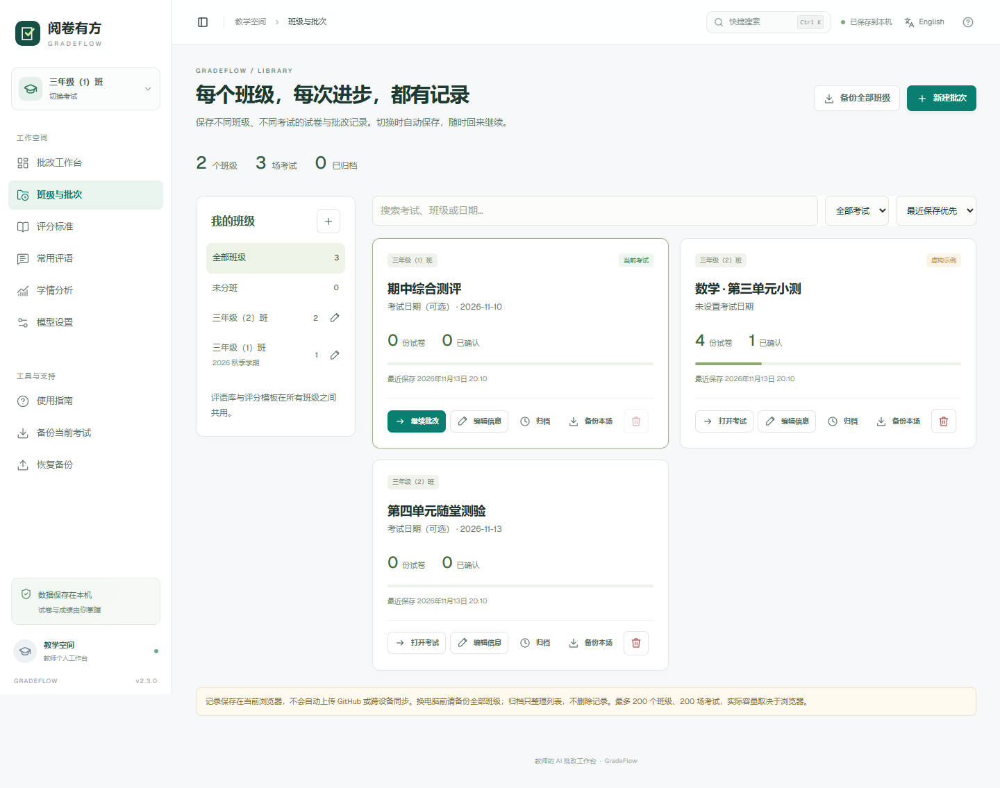

# 阅卷有方 · GradeFlow

**把时间，还给教学。一个由教师掌握最终判断的中英文试卷批改工作台。**

[简体中文](README.zh-CN.md) · [English](README.md) · [调研与路线图](docs/research.md)

**[在线打开中文版](https://jianshengchuanchaun.github.io/paper-grading-assistant/zh/)** · **[Open in English](https://jianshengchuanchaun.github.io/paper-grading-assistant/en/)** · [下载发布版](https://github.com/jianshengchuanchaun/paper-grading-assistant/releases)



从老师已有的试卷批改原型出发，重新设计了界面和批改流程：先定标准，再上传试卷，AI 辅助初评，教师逐题复核，最后导出经过确认的成绩。同一套代码提供中文和英文两个入口。

## 本版已经实现

- **班级与历史批次**：每场考试独立保存试卷、评分标准、成绩和复核进度。支持新建 / 重命名班级、移动考试、搜索、归档 / 取消归档，随时切换继续批改。
- **结构化评分标准**：按题设置题号、满分、答案和得分规则，支持补充说明、文字导入和可复用模板。
- **图片和多页 PDF**：支持 JPG、PNG、WebP、PDF，拖拽上传，学生详情内粘贴图片；PDF 在浏览器本地展开。
- **并排复核**：左侧看原卷，右侧逐题改分和写评语；支持缩放、旋转、切换页面和左右方向键切换学生。
- **按题批改不同学生**：固定一道题，连续切换学生；支持待复核 / 重点核对筛选、逐题进度和「确认本题并下一位」。所有题目复核完成后才确认整卷成绩。
- **常用评语库**：内置 9 条可编辑中英文评语，支持自定义、分类、搜索和收藏；在题目内一键追加，保留已有反馈，重复点击不会重复插入。
- **保留判断过程**：分别保存 AI 初评分、教师得分、教师评语和修改记录。无法辨认或漏评的题目保留为空，避免被当成零分。
- **正式成绩需要确认**：只有当前评分标准下、得分完整、经过教师确认的成绩，才进入正式 CSV 和学情统计。
- **刷新后继续工作**：每场考试分别存储在本机浏览器，模板和评语库共用。可备份单场考试或全部班级，自动迁移 v2.0 / v2.1 记录；多个标签页同时修改时会阻止旧页面覆盖新记录。
- **学情分析**：平均得分率、及格率、分数段分布、逐题得分率和建议重点讲评的题目。
- **成绩与反馈导出**：Excel 可打开的 CSV；每生反馈可打印，或在浏览器打印窗口中保存为 PDF。
- **自选视觉模型**：支持兼容 Chat Completions 的视觉接口、自定义地址和模型；可选本地中转解决部分接口跨域限制。
- **中英双版本**：`/zh/`、`/en/` 独立入口，也可以在界面中切换。界面控件和 AI 反馈提示词均支持双语。
- **无需密钥的演示**：内置虚构学生、试卷和分数，全程不调用 AI，界面与导出均标注为示例。

## 快速开始

安装 **Node.js 22.13 或以上版本**，推荐 Node.js 24，然后在项目目录运行：

```sh
npm ci
npm run build
npm start
```

打开 [本地工作台](http://localhost:4173/)、[中文入口](http://localhost:4173/zh/) 或 [英文入口](http://localhost:4173/en/)。先点击「体验示例」，即可完整体验导入、复核、统计与导出。

实际使用的流程：

1. 在「班级与批次」新建班级，再点击「新建批次」填写考试名称和日期，旧考试会保留。在「评分标准」录入题号、满分与评分依据，也可复用当前标准或已有模板。文字文件只导入补充说明，不会自动生成题目列表。
2. 导入试卷。**每个文件对应一个学生，一份 PDF 请只放一位学生的试卷。** 同一学生的补充照片可以在详情中继续添加。
3. 在「模型设置」中配置支持图像输入的接口。「测试连接」仅验证文本请求，视觉能力需要用示例图片验证。
4. 点击「批改待处理」。任务按顺序执行，可以中途停止；已成功的结果会保留，不会无故重复扣费重批。单独重新批改会提示替换原结果。
5. 对照原卷核对分数与评语。可以「按学生复核」确认整卷，也可以「按题复核」连续检查不同学生的同一道题，并从常用评语库追加反馈。
6. 导出正式成绩、打印个人反馈，或备份工作区以便下次继续。

直接双击 `index.html` 可以体验演示和基本图片流程。PDF 和本地中转需要通过 HTTP/HTTPS 打开；不同浏览器也可能限制 `file://` 页面的存储或接口请求，因此推荐本地服务或静态 HTTPS 部署。

## 新增功能怎么用

**常用评语库**：进入左侧「常用评语」，按「表扬与肯定」「待改进」「学习建议」管理反馈。同一条评语可以填写中文和英文；使用时按当前界面语言选择文本，缺少对应语言时会标明使用另一种语言的原文，不会自动翻译。收藏常用条目，或用任一语言搜索。在题目卡片中展开「常用评语」并点击条目，即可追加到教师评语；已有内容会保留。后续修改或删除模板，不会改变已经写给学生的反馈。



**按同一道题批改不同学生**：完成 AI 初评后，在工作台点击「按题复核」，选择题号，通过学生名单或左右方向键切换。点击「确认本题并下一位」，会保存当前题目的复核状态，并跳到当前筛选中下一位待复核学生。顶部显示本题的复核进度；可以筛选「本题待复核」或「重点核对」，也可以随时切回按学生查看整卷。


没有得分的题目需要先补分；未完成初评或评分标准已变化的试卷，需要先批改。确认一道题只确认这道题，所有题目都有得分且完成复核后，整卷才进入正式成绩。修改分数或评语会撤销该题和整卷的确认，其他题目的复核记录保留。两项功能均在本地运行，不额外调用 AI。备份包含评语库和复核进度；恢复没有评语库的旧备份时，会保留当前评语库。

## 班级、历史记录与备份



进入「班级与批次」管理班级和考试。新考试可以复用评分标准，不复制学生与成绩；旧考试会保留。工作台顶部的下拉框可以快速切换，历史卡片也能直接打开考试。班级可重命名，考试可修改名称、日期或所属班级，并按保存时间 / 考试日期排序。归档只整理列表，不删除记录，也不锁定编辑；选择「已归档」后仍可打开继续批改。

| 操作 | 作用 |
| --- | --- |
| 备份当前考试 / 备份本场 | 下载这一场考试的试卷、结果、修改记录，以及模板和评语库；沿用 version 2 JSON 格式。 |
| 备份全部班级 | 下载所有班级、考试（包括归档）、模板和评语库；使用 version 3 JSON 格式。无需额外写入数据库，存储空间不足时也可导出。 |
| 恢复单场备份 | 导入为新考试，保留已有考试，并恢复备份内的共用模板 / 评语；旧备份没有评语库时保留当前库。 |
| 恢复全部班级备份 | 确认后替换整个本机资料库。全部内容先校验，再一次性写入；请先备份要保留的记录。 |
| 删除考试 | 确认后永久删除这一场考试。当前考试需先切换到另一场，才能删除。 |
| 删除空班级 | 该班级没有任何考试（包含归档）时才允许删除。 |

**数据保存在当前浏览器，不会因为项目发布到 GitHub 就自动上传或跨设备同步。** 同一浏览器下在线版的中文 / 英文入口共用资料；本地版、其他浏览器、其他用户配置或其他电脑有各自的存储。换电脑请用全部班级备份迁移。清除网站数据或关闭临时浏览器配置可能导致记录丢失。多标签页发生写入冲突时，旧页面需要先备份未保存修改，再刷新继续。

最多 200 个班级、200 场考试；每场考试沿用最多 500 位学生、每生 20 页的限制，实际容量取决于浏览器空间。备份导入上限为 180 MB；目前没有进行大班级容量压测，也没有云同步。

录屏介绍可直接使用 [B 站操作与口播讲稿](docs/BILIBILI_SCRIPT.zh-CN.md)，另附 [英文演示指南](docs/DEMO_GUIDE.en.md) 与 [虚构示例试卷](docs/demo-materials/README.md)。

## 接入模型

### 浏览器直连

选择服务商预设，填写该服务当前可用的视觉模型 ID 和 API 密钥。密钥**仅保留在当前页面内存**，刷新后需重新输入，不进入本地数据库或备份文件。

**DeepSeek**：在「模型设置 → 浏览器直连」选择 **DeepSeek**，会自动填入 `https://api.deepseek.com` 和 `deepseek-flash`。输入自己的 DeepSeek API 密钥，点击「保存」，再「测试连接」。测试连接只发送文本；之后请用一份试卷验证图像识别和评分。根据 [DeepSeek 官方视觉接口文档](https://api-docs.deepseek.com/guides/vision/)，`deepseek-flash` 支持图片输入；更换模型前请确认其视觉能力。此预设的直连请求关闭深度思考，以将输出额度用于连接回复和评分 JSON。实际使用按服务商规则计费。

服务商必须允许浏览器跨域访问；若不允许，请使用本地中转。模型名称、价格、账号权限和视觉能力可能变化，本项目不承诺任何模型永久免费，也不宣称所有服务已经实测兼容。

### 可选本地中转

将 `.env.example` 复制为 `.env`，填写：

```dotenv
OPENAI_BASE_URL=https://你的服务地址/v1
OPENAI_MODEL=你的视觉模型名称
OPENAI_API_KEY=你的密钥
PORT=4173
```

重新运行 `npm start`，在设置中选择「本地中转（.env）」。密钥保留在本地服务中。服务仅监听本机回环地址，只接受同源请求，目标地址与模型由 `.env` 固定，网页不能指定任意转发目标。

这是个人电脑上的本地辅助服务，并非提供多用户账号的生产后端。**GitHub Pages 不能运行这个中转服务**；在线静态版本应使用允许跨域的浏览器直连接口。

## 数据和评分边界

- 试卷、成绩和模板保存于当前浏览器环境，清理浏览器数据会删除它们。更换设备或清理数据前请导出备份；备份是包含学生资料的明文文件。
- 真实批改会向你配置的服务发送评分细则与试卷图片。录入的学生姓名不额外加入提示词，但试卷图片中可见的姓名仍会被服务看到；本版没有自动匿名化图片。
- 题号和满分以教师标准为准。重复题号、未知题号和越界分数会被拒绝；漏评或无法辨认的题目保持空分；模型满分与标准不一致时提示核查。
- 修改评分标准或评分尺度后，旧结果会标记为过期。改分、修改教师评语需要再次确认；变更试卷页面会清除对应结果。
- AI 的复核标记不等于经过校准的置信度。所有成绩仍需教师核验，本项目尚未完成真实教学数据上的准确率评测。
- 不含广告、统计埋点、远程字体、自动云同步，也不包含任何生产 API 密钥。

## 使用限制

每个浏览器站点可保存多场考试，一次选择其中一场批改。每场考试上限为 **500 位学生、100 道题、每生 20 页**；**每个输入文件最多 25 MB，导入备份最多 180 MB**。实际容量还取决于浏览器存储配额与设备内存。图片长边会压缩到 1900 像素以内；本地中转单次请求限制 30 MB，服务商也可能有更小限制。

暂未实现：混合学生扫描件自动分卷、批改前编辑 OCR、原卷画笔批注、教务 / LMS 同步、多人协同、自动解析评分标准、账号系统和经过验证的批改基准。加密 PDF 请先解锁；HEIC 请先转换为 JPG / PNG。

## 开发和部署

```sh
npm run check
npm run build
npm run test:ui
```

`check` 验证评分、备份、CSV 和中转规则；浏览器测试覆盖真实界面流程。Windows 使用已安装的 Edge，其他系统先执行 `npx playwright install chromium`。

项目采用原生 HTML / CSS / JavaScript。PDF.js 是唯一运行时依赖，构建时复制到本地静态资源，不依赖 CDN。核心文件说明见 [英文 README](README.md#development-and-checks)。

本项目的在线版使用 `gh-pages` 分支发布构建后的 `dist/` 内容，包含中文和英文入口。如果部署自己的 Fork，请将 `dist/` 的内容放到 `gh-pages` 分支根目录，然后在 **Settings → Pages → Deploy from a branch** 中选择 **gh-pages / (root)**。

[`docs/workflows/`](docs/workflows/) 提供可选的自动测试和手动部署工作流模板。若要启用，将文件复制到 `.github/workflows/`，并在 Pages 设置中选择 GitHub Actions。通过 GitHub CLI 上传可执行工作流需要额外的 `workflow` 授权；本次发布先提供模板，尚未启用自动工作流。

## 参考与许可

功能调研参考了 [ExamGrader](https://github.com/CCU-Bioinformatics-Lab/ExamGrader)、[朱批 ZhuPi](https://github.com/Qnh233/zhupiAI)、[CorrectExam](https://github.com/correctexam/corrigeExamFront)、[OpenGrader](https://github.com/ISC-HEI/opengrader) 和 [Gradescope](https://guides.gradescope.com/hc/en-us/articles/37290703633677-Submission-navigation-and-keyboard-shortcuts)。没有复制这些项目的源码、图片或专有设计。具体取舍见 [调研记录](docs/research.md)。

应用代码采用 [MIT 许可证](LICENSE)，PDF.js 遵循 Apache-2.0，其许可证随构建一起分发。截图内全部为程序生成的虚构示例。
